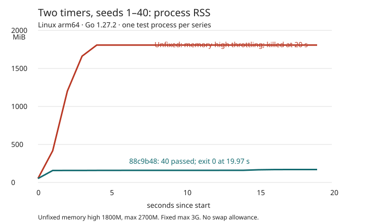

# tigerstore #531: seed memory growth

Diagnosis only. Do not merge this branch. No PR was opened.

Host: Linux arm64, Go 1.27.2. This is the shared 11 GiB / 8-core host from the issue. Builds and tests ran sequentially with `GOFLAGS=-p=2`. Every reproduction had a cgroup memory cap, at most 3 GiB, and no swap allowance. The stalled comparison used `MemoryHigh=1800M`, `MemoryMax=2700M` and a 20-second service deadline. It was not allowed to reach the issue's original 4–5 GB.

## Cause

`gosimruntime/sema.go` kept a process-global hash table of semaphore entries. Each entry held a `*uint32` address. Removing an aborted goroutine's waiter emptied its queue, but did not remove its semaphore entry. `maybefree` cleaned empty entries only on another visit to that hash bucket. GC could not collect the object containing that address until then.

In this reproduction, the final `SyscallMachineStop` waited on `Syscall.Sema`. The call stopped its own simulated machine, which removed the waiter. Ending the run then aborted the OS coroutine before `trampolineMachineStop` reached `syscall.Complete()`. The empty table entry survived.

The retaining path is:

```
process-global semas[bucket]
  -> sema.ptr -> Syscall.Sema (interior pointer keeps Syscall alive)
  -> Syscall.OS -> GosimOS.simulation -> Simulation.timeoutTimer
  -> timeTimer.pp -> gosimruntime.Timer.Machine -> Machine.globals
```

Sources: `gosimruntime/sema.go`, `gosimruntime/runtime.go` (`abort`, `SetAbortError`), `internal/simulation/syscallabi/syscall.go`, `internal/simulation/gosim_gen.go` (`SyscallMachineStop`, `trampolineMachineStop`), `internal/simulation/simulation.go` (`stopMachine`, `Runtime`), `internal/hooks/go127/time.go` and `gosimruntime/time.go`.

The records were small. Their retained graphs were not. A globals allocation was 33,779,384 bytes. The diagnostic run had 12 empty entries after 225 internal runs, 28 after 250, and 68 after 300. Heap profiles attributed about 99% of retained bytes to `reflect.New -> allocGlobals`, mainly the default/OS machine, not to goroutine stacks. An earlier forced-GC snapshot still had 1.81 GiB live, with 98.95% in `reflect.unsafe_New`. See the raw profiles and their `*.top.txt` reports.

The harness amplifies the leak. `TestMain` starts a simulation for every entry in `allTestsSlice`, then filters with `TestEntrypoint` *inside* that simulation. This package has 213 entries including the reproduction. So `-run '^TestSeedGrowthTwoTimers$' -seeds 1-40` starts 8,520 simulations, including skipped tests. Each has an OS machine and a userspace machine. This explains the rate of growth. The prototype does not change filtering.

## Prototype

- `45717f89a196a590283f4545def98803ce1fe090`: move the semaphore table into `scheduler`, add the two-timer reproduction and a weak-pointer retention regression.
- `88c9b48de93461f8eff809ceb3115013d625fbaf`: clear a popped `semaPool` slot too. Its backing array otherwise kept a reused entry alive. The regression now forces pool reuse.

The pool-reuse regression fails on the first prototype and passes on the second. The original retention regression fails on the old global-table implementation. Both failures and the passes are recorded in `logs/regression-*.log`.

No scheduler choices or random draws were added. Existing determinism tests pass. This is not a claim that checksums are stable across differently linked binaries: checksums include relative function addresses (`newGoroutine` / `relativeFuncAddr`).

## Results



The clean baseline was `d38cce99c9e1` production source, plus the two test files from the prototype. To build it, I restored just `gosimruntime/runtime.go` and `gosimruntime/sema.go` from `d38cce9`. `logs/clean-baseline.patch` records that reversal relative to the first prototype. There was no diagnostic goroutine in this binary.

The final clean binary was built on `88c9b48`, with no instrumentation. Both binaries ran the same two-timer test from the same package, in one process, with seeds 1–40.

- Baseline, seed 1 alone: passed in 0.75 s, peak RSS 188,416 KiB.
- Baseline, seeds 1–40: only seed 1 reported PASS. RSS went from 426,548 KiB at 1 s to 1,850,712 KiB at 4 s. No further test result appeared before the 20 s deadline. The service was killed after the quit grace period. Its memory-high counter reached 86,303; no OOM kill occurred. Native threads were observed in `mem_cgroup_handle_over_high` and `folio_wait_bit_common`.
- Final prototype, seeds 1–40: all 40 passed. Exit 0 in 19.97 s. Peak RSS 227,388 KiB. One-second samples after startup stayed between 161,420 and 174,324 KiB. See `logs/final-clean.log` and `logs/final-rss.txt`.

The instrumented baseline gave matching growth and a stack snapshot at the onset of the stall (`baseline-profiles/stacks-04.txt`). The scheduler was suspended in `Coro.Next`; a simulated coroutine was runnable in package initialization. Other coroutines were parked in the dispatcher and network queue. This is not an all-coroutines-blocked deadlock. The capped run's stall was Linux memory throttling/reclaim. **Inference:** the uncapped 4–5 GB hang in the original review was the same retention causing host memory pressure. I did not consume 4–5 GB to prove that exact threshold on this shared host.

`before-instrumentation.patch` and `seed_growth_diag.go.txt` reconstruct the final diagnostic baseline from `d38cce9` (also copy in the reproduction test). The patch includes an unused scheduler-local table left from testing the prototype; baseline semaphore lookups still use the old global table. The helper creates a native watcher that records heap profiles, stacks, memory and run counts. The forced-GC profiles came from an earlier variant with the exit threshold set to `HeapAlloc > 1800<<20`, rather than 20/25 seconds. These are diagnostic changes, not the clean comparison binaries.

`logs/fixed-diag.log` is an earlier instrumented run of the first prototype, before pool-slot clearing. All 40 seeds passed in 17.809 s of test time. Its sampled heap stayed at 66–131 MiB while it allocated over 500 GB cumulatively across skipped simulations. The final clean RSS comparison above is on the complete prototype.

## Reproduce safely

From the fork checkout, with Go 1.27.2:

```sh
export GOFLAGS=-p=2
systemd-run --user --scope -p MemoryMax=3G -p MemorySwapMax=0 \
  go build -C cmd/gosim -o ../../.gosim/gosimtool .

# The short CLI reproduction. On the unfixed source this may hit its cap.
systemd-run --user --scope -p MemoryHigh=1800M -p MemoryMax=2700M \
  -p MemorySwapMax=0 timeout -s QUIT -k 3s 60s \
  .gosim/gosimtool test -v -run '^TestSeedGrowthTwoTimers$' \
  -seeds 1-40 ./internal/tests/behavior
```

For the recorded RSS comparison, build first, then measure just the resulting test process. This avoids attributing compiler/translator RSS to the simulation:

```sh
systemd-run --user --scope -p MemoryMax=3G -p MemorySwapMax=0 \
  .gosim/gosimtool build-tests ./internal/tests/behavior
bin=.gosim/metatest/linux_arm64/translated-github.com-jellevandenhooff-gosim-internal_-tests-behavior.test
systemd-run --user --scope -p MemoryHigh=1800M -p MemoryMax=2700M \
  -p MemorySwapMax=0 timeout -s QUIT -k 3s 60s \
  /usr/bin/time -v "$bin" -test.run '^TestSeedGrowthTwoTimers$' -seeds 1-40
```

To compare the old implementation without changing the test:

```sh
git restore --source=d38cce9 -- gosimruntime/runtime.go gosimruntime/sema.go
# Rebuild and run the capped commands above.
git restore -- gosimruntime/runtime.go gosimruntime/sema.go
```

Do not run the unfixed binary without a cap. RSS sampling and kernel wait-channel evidence are in `logs/pressure-clean.txt` (clean baseline), `logs/pressure.txt` (diagnostic baseline), and `logs/final-rss.txt` (final fix).

## Existing tests

All passed on `88c9b48`; see `logs/final-suites.log`. Every command below ran sequentially in one scope with `MemoryMax=3G`, `MemorySwapMax=0`, `GOFLAGS=-p=2`, and `GOSIMTOOL="$PWD/.gosim/gosimtool"`:

```sh
.gosim/gosimtool build-tests ./internal/tests/behavior ./nemesis
go test -count=1 -parallel=2 -ldflags=-checklinkname=0 -tags=linkname ./...
go test -C cmd/gosim -count=1 -parallel=2 ./...
.gosim/gosimtool build-tests -race ./internal/tests/behavior ./nemesis ./internal/tests/race/testdata
go test -count=1 -parallel=2 -ldflags=-checklinkname=0 -tags=linkname -race ./...
go test -C cmd/gosim -count=1 -parallel=2 -race ./...
```

This includes `TestGosim` (all behavior tests), `TestMetaDeterministic`, `TestMetaSeeds`, the race-verdict tests, metatesting, runtime, scripts, translator and CLI tests, in both plain and race builds. An initial plain-suite attempt omitted `GOSIMTOOL`; fallback auto-builds then could not resolve the CLI's separate module. Setting the documented override fixed that setup error. No test failure was suppressed.
